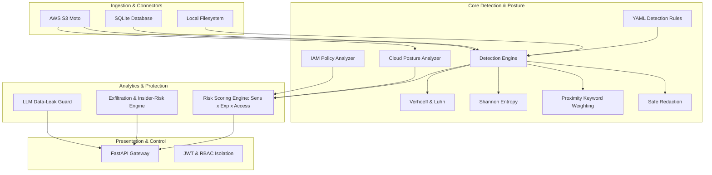

# VaultSight: Architecture & Engineering Design

## 1. High-Level Architecture

VaultSight implements a modular, decoupled pipeline for Data Security Posture Management (DSPM). Each component maintains a single, defense-in-depth responsibility:

---

## 2. Core Modules & Responsibilities

### `vaultsight.detectors`
- **`engine.py`**: Compiles YAML rules and executes scans against text. Combines regex matching, allowlist suppression, checksum checks, entropy analysis, and proximity keyword boosting.
- **`checksums.py`**: Pure Python implementations of the **Verhoeff** permutation algorithm (for Indian Aadhaar validation) and **Luhn** algorithm (mod 10 check for credit cards).
- **`entropy.py`**: Shannon entropy calculation ($H(X) = -\sum p(x) \log_2 p(x)$) for uncovering generic high-entropy API secrets and tokens.
- **`redact.py`**: Implements safe secret masking and placeholder allowlisting.

### `vaultsight.connectors`
- **`LocalFilesystemConnector`**: Walks filesystem directories with path-traversal prevention (`safe_resolve`), verifying all targets remain within the allowed scan root.
- **`SQLiteConnector`**: Connects via read-only URI (`?mode=ro`) to enumerate user tables, columns, and records.
- **`S3Connector`**: Integrates with `boto3` and moto to list buckets and paginate S3 object bodies safely.

### `vaultsight.posture`
- **`S3PostureAnalyzer`**: Audits S3 buckets for missing Block Public Access, public ACLs (`AllUsers`), public bucket policies (`Principal: *`), default encryption, server access logging, and object versioning.
- **`IAMPolicyAnalyzer`**: Analyzes IAM policy JSON documents for administrative wildcards (`*:*`), service wildcards (`s3:*` on `*`), and privilege escalation vectors (`iam:CreateAccessKey`, `iam:AttachUserPolicy`).

### `vaultsight.risk`
- **`RiskScoringEngine`**: Computes normalized DSPM risk scores using the formula:
  $$\text{Risk Score} = \frac{\text{Data Sensitivity} \times \text{Exposure} \times \text{Access Breadth}}{10.0}$$
  Outputs normalized scores (0 to 100), severity levels (`CRITICAL`, `HIGH`, `MEDIUM`, `LOW`, `INFO`), and actionable remediation steps.

### `vaultsight.exfiltration`
- **`ExfiltrationDetector`**: Audits synthetic access logs for bulk downloads, off-hours access, first-seen IP addresses, volume spikes (>3x baseline), and role-sensitivity privilege mismatches.

### `vaultsight.api`
- **FastAPI Gateway**: Provides authenticated endpoints for starting scans, inspecting findings, and viewing reports. Implements JWT authentication, role-based access control (`admin`, `analyst`, `viewer`), per-user data isolation (IDOR protection), and secure HTTP headers.

### `vaultsight.llm_guard`
- **`LLMDataGuard`**: Intercepts prompts intended for LLMs, redacts sensitive PII and financial numbers, blocks transmission if high-confidence credentials are discovered, and prevents basic prompt-injection jailbreaks.
