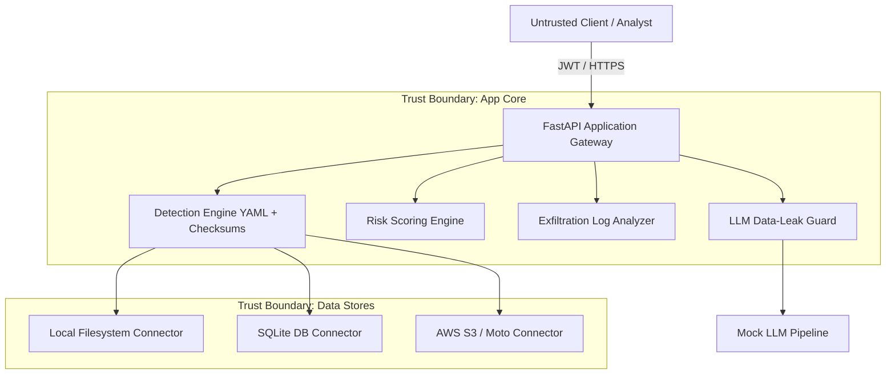

# Threat Model: VaultSight DSPM Toolkit

## 1. System Overview & Trust Boundaries
VaultSight is a lightweight Data Security Posture Management (DSPM) toolkit designed for defensive security engineering. It audits data stores (local filesystem, SQLite databases, AWS S3 buckets), classifies sensitive data, scores exposure risks, monitors access logs for exfiltration anomalies, and guards LLM ingestion pipelines.

### Trust Boundaries
1. **External Client / Untrusted Boundary**: Any client querying the FastAPI endpoints (`/auth`, `/scans`, `/reports`). Untrusted inputs, malformed JSON, and traversal characters originate here.
2. **Application Boundary (VaultSight Core)**: Operates the detection engine, scoring logic, access log analyzers, and LLM guard. Holds in-memory secrets and database session state.
3. **Data Store Connector Boundary**: Boundary connecting to local filesystems, SQLite relational storage, and AWS S3 APIs (simulated with moto).
4. **Third-Party / LLM Integration Boundary**: Downstream large language models consuming user prompts.

---

## 2. STRIDE Threat Analysis

| Threat (STRIDE) | Attack Vector / Scenario | Potential Impact | VaultSight Defense & Mitigation |
| :--- | :--- | :--- | :--- |
| **Spoofing** | Attacker crafts forged JWT or accesses API without authentication. | Unauthorized API access as an analyst or admin. | HMAC-SHA256 signature verification via `python-jose`, token expiration claims (`exp`), and constant-time password verification with `passlib` bcrypt. |
| **Tampering** | Parameter tampering or path traversal (e.g. `../../etc/shadow`) in `/scans` target path. | Reading arbitrary host files outside intended scan root. | Strict path validation with Pydantic `@field_validator` and `LocalFilesystemConnector.safe_resolve()` enforcing `Path.resolve().relative_to(base_dir)`. |
| **Repudiation** | Insider downloads massive sensitive records and claims innocence. | Deniability of data theft or intellectual property leakage. | Access logs record user ID, role, client IP, target resource, and byte transfer. `ExfiltrationDetector` alerts on off-hours and bulk anomalies. |
| **Information Disclosure** | Sensitive findings logged or returned in plaintext over API; raw secrets exposed in memory dumps or error logs. | Breach of customer Aadhaar, PAN, credentials, or credit cards. | Detectors mask values with `redact_secret()` before storing `redacted_preview`. Raw secrets are never stored, logged, or returned in API responses. |
| **Denial of Service** | Flooding API with massive scan payloads or oversized request bodies (>10MB). | Memory exhaustion or process starvation on worker nodes. | HTTP middleware enforces 10MB body size ceiling and an in-memory sliding window rate limiter (120 req/min per IP). |
| **Elevation of Privilege** | Low-privilege viewer accounts exploiting IDOR to read sensitive scans, or modifying roles via mass assignment. | Viewing confidential scans of other users or escalating to admin. | User-isolated database queries (`ScanDB.owner_id == current_user.id`), explicit RBAC dependencies (`require_analyst_or_admin`), and strict Pydantic input models. |

---

## 3. Data Store & Pipeline Security Controls
- **Never Store or Log Raw Secrets**: All matches store only a redacted mask (`AK************LE`).
- **Fail-Closed Verification**: Checksums (Verhoeff for Aadhaar, Luhn for credit cards) discard malformed strings before any alert generation.
- **Strict Data Store Read-Only Mode**: SQLite connectors open databases with SQLite URI `?mode=ro` preventing accidental writes or data mutation.
